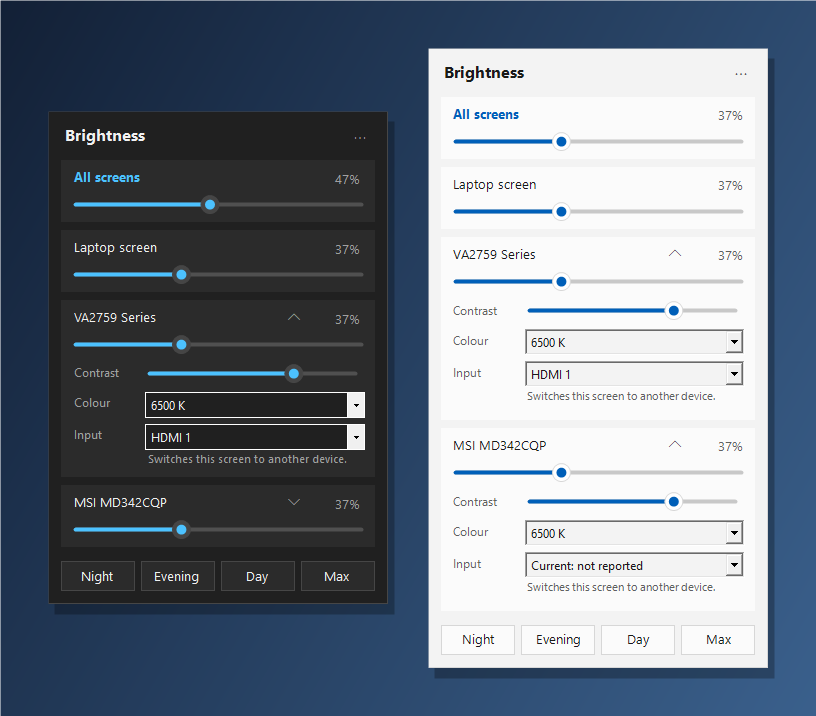
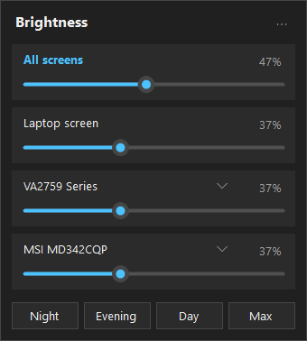
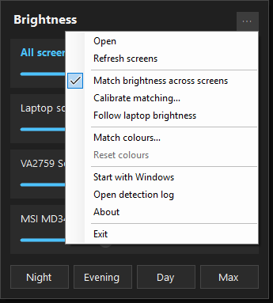
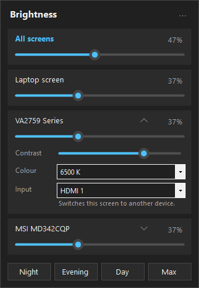
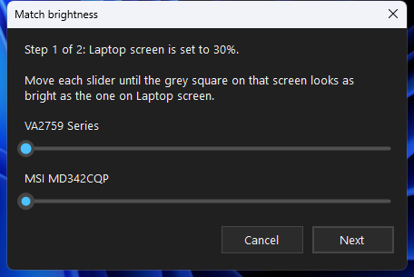
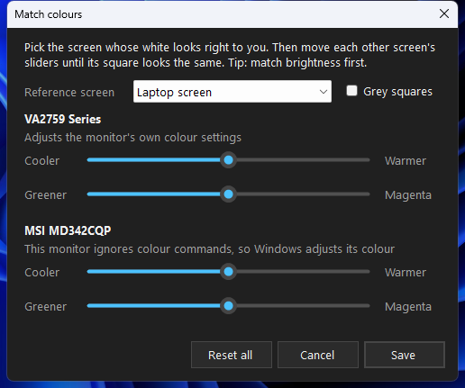

# Brightness Control

**Brightness and colour for every screen, from the Windows taskbar.** External monitors, the laptop screen, all at once or one by one, without reaching for the monitor's buttons.



- **Every screen in one place.** External monitors are controlled over **DDC/CI**, the laptop screen through Windows.
- **All screens slider** and **Night / Evening / Day / Max** presets.
- **Monitor settings:** contrast, colour preset (sRGB, 6500 K, …) and input source, for monitors that support them.
- **Brightness matching:** one slider looks equally bright on every screen, even when their panels differ.
- **Colour matching:** make whites look the same on every screen.
- **Follow laptop brightness:** external monitors follow the laptop's brightness keys.
- **Doesn't lose monitors:** screens that don't answer stay listed and are checked again automatically.
- Light/dark theme, sharp on high-DPI screens, keyboard and screen-reader friendly.
- **Private:** collects no data and never goes online ([privacy policy](docs/privacy.md)).

## Install

Requires Windows 10 (version 1809 or later) or Windows 11.

### Download (portable)

1. Open the [latest release](https://github.com/riyajkm/brightness-control/releases/latest) and download the zip for your PC:
   - `BrightnessControl-…-win-x64.zip` for most PCs (Intel / AMD).
   - `BrightnessControl-…-win-arm64.zip` for ARM laptops (Snapdragon).

   Not sure? Settings > System > About > *System type*.
2. Unzip it to a folder you'll keep, for example `%LOCALAPPDATA%\Programs\Brightness Control` (paste that into File Explorer's address bar).
3. Double-click **BrightnessControl.exe**. Nothing else to install; .NET is built in.
4. Windows may show **"Windows protected your PC"** because the download is new and not yet signed. Click **More info > Run anyway**.
5. The panel opens and a sun icon appears in the taskbar. If you don't see the icon, click **^** next to the clock and drag the sun onto the taskbar.
6. Optional: right-click the sun and turn on **Start with Windows**.

To uninstall, choose **Exit** from the tray menu, delete the folder, and delete `%LOCALAPPDATA%\BrightnessControl` (settings and log).

### Microsoft Store

Coming soon. The Store version installs and updates automatically.

### Before you start: let your monitors be controlled

Most monitors support this, but some have it switched off. In each external monitor's own on-screen menu:

1. Turn **DDC/CI** on (often under *Setup* or *System*).
2. Set **ECO mode** to *Standard* and turn off **Dynamic Contrast**. These lock brightness.
3. Connect the monitor directly to the PC if you can. Docks, USB display adapters and some KVM switches block DDC/CI.

## Use

### The panel

Click the sun icon to open the panel. Each screen gets a slider; **All screens** moves them together, and the presets set everything in one click.



- Drag a slider, scroll on it with the mouse wheel, or use the keyboard: arrows, Page Up / Page Down, Home / End.
- Esc or clicking elsewhere closes the panel.
- Right-click the sun icon, or use **⋯** in the panel, for everything else:



### Monitor settings

Click the arrow next to a monitor's name for its **contrast**, **colour preset** and **input source**. Only the settings that monitor reports supporting are shown. Switching the input shows another device's picture on that screen.



### Make screens equally bright

The same percentage rarely looks the same on two screens. **Calibrate matching…** fixes that in two steps:

1. A grey square appears on every screen. Your laptop (or first screen) is set to a dim level.
2. Move each other screen's slider until its square looks as bright as the reference. Click **Next**.
3. Do the same at a bright level, then **Save**.

From then on, **All screens**, the presets and *Follow laptop brightness* keep every screen looking alike. Your screens go back to their previous brightness when the wizard closes. To switch matching off, untick **Match brightness across screens**.



### Make screens show the same colours

**Match colours…** puts a white square on every screen.

1. Under **Reference screen**, pick the screen whose white looks right to you.
2. For each other screen, move **Cooler ↔ Warmer** and **Greener ↔ Magenta** until its square looks the same. Changes show immediately.
3. Tick **Grey squares** to double-check on grey, then **Save**.



How it's applied:

- **Monitors that accept colour commands** are adjusted in their own settings. They usually switch to their *User* colour mode, and they keep the colour even when the app isn't running.
- **Laptop screens and monitors that ignore colour commands** are adjusted through Windows, while the app is running. Turn on **Start with Windows** to keep them matched.

**Reset colours** in the menu puts every screen back exactly as it was. Match brightness first: screens at different brightness never look the same colour. Whites and greys can match closely; strong colours may still differ a little, because each panel can show a different range of colour.

### Follow laptop brightness

Turn on **Follow laptop brightness**. When you press the laptop's brightness keys, or Windows changes the laptop's brightness by itself, external monitors follow, through brightness matching if you've calibrated it.

## Troubleshooting

- **A monitor is missing or says "Not answering yet".** Check the monitor menu steps above, then right-click the sun icon and choose **Refresh screens**. Opening the panel also re-checks.
- **A monitor ignores brightness changes.** Its ECO or picture mode may lock brightness. Switch it to *Standard* in the monitor's menu.
- **Find out what happened.** Right-click the sun icon and choose **Open detection log**. It lists every screen Windows reports and what each one answered. Attach it to an issue if you need help.
- **Colours of the laptop screen change back.** Windows Night Light and some other apps adjust the same colour output. Opening the panel re-applies your matched colours.

Questions or problems: [open an issue](https://github.com/riyajkm/brightness-control/issues).

## Build from source

Needs the [.NET 10 SDK](https://dotnet.microsoft.com/download/dotnet/10.0) (`winget install Microsoft.DotNet.SDK.10`).

```powershell
powershell -ExecutionPolicy Bypass -File .\build.ps1          # bin\BrightnessControl.exe
powershell -ExecutionPolicy Bypass -File .\build-release.ps1  # dist\*.zip portable downloads
dotnet run --file tests/unit.cs -- bin/BrightnessControl.dll   # unit tests
```

### Microsoft Store package

Also needs the Windows SDK (`winget install Microsoft.WindowsSDK.10.0.26100`) for `makeappx` and `makepri`.

```powershell
# Local test build with a placeholder identity
powershell -ExecutionPolicy Bypass -File .\build-msix.ps1

# Store build: identity values from Partner Center > Product management > Product identity
powershell -ExecutionPolicy Bypass -File .\build-msix.ps1 -IdentityName "<Package/Identity/Name>" `
    -Publisher "<Package/Identity/Publisher>" -PublisherDisplayName "<Publisher display name>" `
    -DisplayName "<the app name you reserved>"
```

Output: `dist\BrightnessControl_<version>.msixbundle` (x64 + arm64, self-contained) to upload to Partner Center. The Store signs it. Listing text is in [docs/store-listing.md](docs/store-listing.md). Icons are generated by `dotnet run --file tools/make-assets.cs`.

## Roadmap

**1.0 (this release):** detection that doesn't drop monitors, monitor settings from capabilities, brightness matching, colour matching, follow laptop brightness, theme/DPI/accessibility, Store packaging.

**Later:**

- [ ] Global hotkeys
- [ ] Schedules and sunrise/sunset
- [ ] Ambient light sensor, on laptops that have one
- [ ] Software dimming: "extra dim" below 0%, and control for screens with no DDC/CI
- [ ] More monitor settings: volume, power mode, monitor info (EDID)

Research notes: [docs/feature-research.md](docs/feature-research.md).

## Layout

```
src/BrightnessControl/          app source (.NET 10, Windows Forms), one class per file
  Monitors.cs, Screen2.cs       detection and per-screen DDC/CI / WMI I/O
  Capabilities.cs               MCCS capabilities parser
  Matching.cs, MatchWizard.cs   brightness matching
  ColorBalance.cs, ColorWizard.cs  colour matching (RGB gain or gamma ramp)
  LaptopWatcher.cs              follow laptop brightness
  Panel.cs, FlatSlider.cs       the flyout UI
  App.cs, Program.cs            tray icon, menu, startup
packaging/                      MSIX manifest and icons
tests/unit.cs                   unit tests
tools/make-assets.cs            icon generator
docs/                           privacy policy, Store listing, research, screenshots
build.ps1, build-release.ps1, build-msix.ps1   build scripts
```

## License

[MIT](LICENSE)
